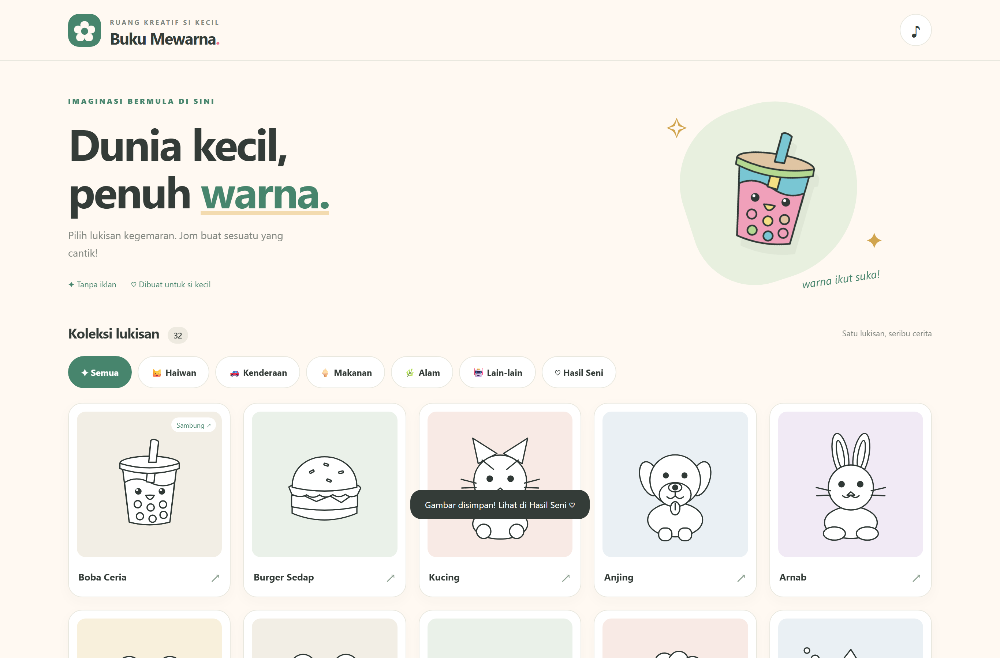

# 🎨 Buku Mewarna

Game mewarna untuk anak — **self-hosted**, **tiada iklan**, jalan sepenuhnya dalam browser.
Satu container Docker (nginx + fail statik), tiada build step, tiada backend, tiada login.

Dibina sebagai alternatif kepada app "coloring page" di Play Store yang penuh iklan.



## Ciri

- **Berus marker bergrafik** — hujung berus ikut titik sentuhan sebenar.
- **Warna terkunci dalam bahagian yang disentuh** — mata, garisan dan bahagian lain kekal terlindung walaupun jari melintas.
- **Bantuan siap warna** — selepas kira-kira 62% bahagian disapu dengan warna yang sama, baki ruang diisi automatik.
- **Isi warna + pemadam** — pemadam boleh membuang sapuan dan warna isi.
- **32 lukisan** — termasuk boba dan burger; awan, bulan, telinga arnab, jalur ikan dan kek dikemaskan.
- **Latar belakang boleh diwarnakan** — sentuh ruang kosong dengan berus, isi warna atau pemadam. Latar pilihan sendiri dan tidak diwajibkan untuk siap lukisan.
- **24 warna + warna sendiri**, saiz berus boleh diubah.
- **Kemajuan automatik** pada peranti/browser yang sama; kembali ke koleksi dan sambung semula.
- **Undur / ulang** (40 tindakan), Ctrl+Z / Ctrl+Shift+Z.
- **Skrin siap + lukisan seterusnya**, bunyi lembut dan konfeti.
- **Simpan PNG 1200×1200** serta 12 hasil terakhir dalam galeri.
- Layout telefon, tablet, desktop dan telefon melintang; tiada iklan atau login.

Kemajuan dan galeri menggunakan localStorage browser. Alamat/origin berbeza mempunyai
simpanan berasingan. Padam data browser juga memadam simpanan tersebut.

## Preview tempatan

Tiada build atau pakej diperlukan untuk menjalankan app:

```bash
python -m http.server 8450 --bind 0.0.0.0 --directory site
```

Buka `http://localhost:8450`. Pada telefon di rangkaian yang sama, gunakan
`http://<IP-komputer>:8450`. Akses telefon bergantung pada firewall komputer.

## Deploy sendiri

```bash
git clone https://github.com/Kengkorok/buku-mewarna.git
cd buku-mewarna
docker compose up -d --build
chmod -R a+rX site          # jika shell anda guna umask 077 (fail jadi 600 -> nginx 403).
                            # Image sendiri betulkan permission bila build, tapi bind mount
                            # membaca fail host — jadi chmod ini masih perlu.
```

Buka `http://<IP-server>:8450`.

Untuk akses dari luar rumah tanpa buka port ke internet, guna Tailscale:
`http://<hostname-tailnet>:8450`.

Tip untuk anak: buka di Chrome → menu ⋮ → **Add to Home screen** → jadi ikon macam app biasa.

## Struktur

```
buku-mewarna/
├── docker-compose.yml      # port 8450 -> 80, bind mount ./site
├── Dockerfile              # nginx:alpine + salinan site/
├── nginx.conf              # gzip + cache header
├── site/                   # app (statik, tiada build step)
│   ├── index.html
│   ├── style.css
│   ├── app.js              # logik: fill, brush, latar, undo, magic, save
│   ├── pages.js            # 32 lukisan (dijana oleh tools/gen_pages.py)
│   └── manifest.webmanifest + icon.svg
└── tools/
    ├── gen_pages.py        # penjana lukisan (SVG, region-based)
    ├── contact_sheet.py    # render semua page jadi 1 PNG untuk semak art
    ├── verify_app.cjs      # ujian browser Playwright — berus, latar, touch, simpan
    ├── verify_app.py       # pembalut keserasian untuk menjalankan suite Node
    └── inspect_gallery.py  # debug layout galeri
```

## Cara lukisan berfungsi

Setiap lukisan ialah SVG 400×400. Bentuk `class="r"` ialah bahagian boleh warna,
`class="d"` ialah garisan, dan `class="f"` ialah butiran hitam.

App membina peta bahagian daripada SVG, mengikut susunan bentuk yang kelihatan.
Berus dikunci pada bahagian awal sehingga jari diangkat. Peta ini turut mengecualikan
bahagian di depan, mata dan garisan. Warna dilukis di kanvas berasingan dan garisan
ditindih semula di atasnya. Transformasi skrin SVG digunakan untuk memadankan sentuhan
dengan lukisan, termasuk selepas resize atau tukar orientasi.

`tools/gen_pages.py` ialah sumber lukisan, `site/pages.js` ialah hasil janaan.
Jangan edit hasil janaan sahaja kerana ia akan ditulis semula.

## Tambah / ubah lukisan

1. Edit `tools/gen_pages.py` — tambah fungsi yang pulangkan string SVG (guna helper `C()`, `E()`, `R()`, `P()`).
2. Daftarkan dalam senarai `PAGES` di bawah fail.
3. Jana semula + semak art:
   ```bash
   python3 tools/gen_pages.py            # tulis site/pages.js
   python3 tools/contact_sheet.py        # tulis sheet.png — tengok semua lukisan sekali
   chmod -R a+rX site
   ```
4. Refresh browser (bind mount — tak perlu rebuild).

Ubah `style.css` / `app.js` pun sama: edit → refresh. Rebuild image hanya perlu bila
ubah `Dockerfile` / `nginx.conf`:

```bash
docker compose up -d --build
```

## Ujian

Hidupkan server preview dahulu. Node.js dan Playwright diperlukan **untuk ujian sahaja**:

```bash
npm install --no-save playwright
npx playwright install chromium
node tools/verify_app.cjs
```

`BM_URL` boleh menetapkan URL lain dan `BM_OUTPUT` boleh menetapkan folder hasil.
Suite ini membuat assertions untuk clipping, kedudukan nib, touch, bantuan siap warna,
pemadam, undo/redo, pemulihan kemajuan, PNG 1200×1200, skrin siap, lukisan seterusnya,
semua 32 lukisan, latar belakang, dan layout 320×568 hingga desktop serta landscape.
Screenshot dan JSON keputusan disimpan dalam `shots/`.

Ujian menggunakan emulasi Chromium; Safari/iPhone dan telefon fizikal masih perlu dicuba.

## Troubleshooting

| Masalah | Sebab / ubat |
|---|---|
| 403 Forbidden pada semua fail | Permission fail `600`. Betulkan: `chmod -R a+rX site` |
| Port 8450 dah dipakai | Tukar mapping dalam `docker-compose.yml` (`"8451:80"`) |
| Perubahan tak muncul | Browser cache — refresh / incognito |

## Lesen

MIT — lihat [LICENSE](LICENSE).
